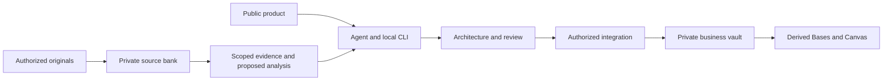

# Architecture

[Español](../es/architecture.md) · [Data model](data-model.md) · [Operations](operations.md)

## Context and goals

Obsidian-Bussines-Brain is a local Python toolkit and an agent operating contract for developing business knowledge with its owner. The public repository distributes code, methodology, skills, templates and synthetic examples. A private business vault contains working knowledge; a separate private bank preserves transcripts. These are three different storage surfaces, not replicas to synchronize.

The goal is usable, correctable knowledge: explain decisions and exceptions, locate the original evidence, and support a real business task. Installing a vault proves infrastructure only. Document count, a valid schema or a successful command does not demonstrate business understanding.

## Components and interfaces

| Component | Implementation | Responsibility and boundary |
|---|---|---|
| Agent instructions | `AGENTS.md`, `.agents/skills/`, `guia/` | Route intent, recover evidence, develop content and obtain applicable approval. No background agent is installed. |
| Business CLI | `scripts/cerebro.py` | Explicit local commands for creation, validation, discovery, documents, relations and navigation. |
| Transfer contract | `contratos/vNext-0.9/` | Portable manifest, blocks, provenance and authority. Import stages and validates files; it is not a universal migration engine. |
| Knowledge model | `modelo/tipos_entidad.json`, `plantilla_boveda/` | 27 candidate operational distinctions, D/X documents and native Bases views; not 27 mandatory notes or departments. |
| Transcript pipeline | `scripts/transcripciones.py`, `scripts/transcripciones_*.py` | Byte custody, permission ledger, segmentation, agent-authored analysis, retrieval and derived candidates. It does not call an LLM. |
| Integration | `scripts/transcripciones_integracion.py`, `scripts/integracion_d.py` | Prepare, verify, back up, apply and restore explicitly authorized batches. No editorial approval is inferred. |
| User interface | Obsidian Markdown, Properties, Bases and Canvas | Readable knowledge and derived navigation. The product does not ship a web frontend or REST server. |

Python uses PyYAML and jsonschema as declared in `requirements.txt`. SQLite supports a rebuildable transcript search index; it is not the primary store. There is no required cloud service, container platform, hosted database, telemetry daemon or automatic model provider.

## Data flow

1. Resolve an existing vault through included `obsidian-router` before reading its files. The active window is not a selector. If the dependency is unavailable, continue authorized work outside the vault and report integration pending.
2. Preserve authorized transcripts before summarizing. Ordinary documents, code and questions do not become transcripts because of their length.
3. Retrieve admissible originals and prior notes, model independent units, then develop proposals. D/X syntheses link canonical owners of changing facts instead of duplicating them.
4. Validate proposed changes and the exact source scope. Apply only through the relevant authorization, hash, backup and journal controls.
5. Test retrieval and a negative case, then inspect the presentation in Obsidian. Navigation remains derived.

## Reliability, performance and security

Bank writes use cooperative locks and immutable/atomic publication. Integration records intent before each replacement, keeps external backups and supports restart and rollback. It does **not** promise one atomic filesystem transaction across the batch or exclusion of an uncooperative editor. Stop writers during application and restoration; a later edit blocks blind rollback.

Transcript queries use lexical retrieval. Request-local caches reduce repeated ledger and dependency work, then expire. Before/after fingerprints reject a changing snapshot with `SNAPSHOT_CHANGED`. This remains optimistic and linear in bank bytes; it is neither semantic retrieval nor an atomic read snapshot. No throughput, latency or enterprise availability target has been accepted.

Sensitivity metadata is not an ACL. Permission records are operator declarations scoped to source version, company, audience and purpose, not identity authentication. Public exports must exclude business sources, manifests containing private bytes and credentials. See [security](security.md).

## Alternatives and remaining gates

Native Bases is the default navigation layer; community plugins are optional and require separate review. Historical research on Obsidian Projects does not authorize installation. Direct copying between public Git and a live business vault would destroy the product/instance boundary. A hosted service, automatic synchronization with ERP/CRM, multiuser ACL and universal migrations are not implemented.

The local software candidate still needs instance-specific GUI/version checks, independent semantic review and owner acceptance for the work being claimed. Older design documents may describe features as future that now have narrow implementations. Use current code, tests and this guide for current capability; keep original design records as provenance.

## Source references

Spanish references: [initial architecture](../ARQUITECTURA.md), [knowledge network](../ESPECIFICACION_RED_CONOCIMIENTO_V0_4.md), [current state](../ESTADO_REAL.md), [open decisions](../DECISIONES_ABIERTAS.md). Documentation structure adapts the architecture template in [ai-cursor-init at the reviewed commit](https://github.com/mgiovani/ai-cursor-init/blob/fc15400e4baab4607f408f5b83fed19263e564e3/.cursor/cursor-init/templates/architecture/architecture_google.md); implementation claims come from this repository.
