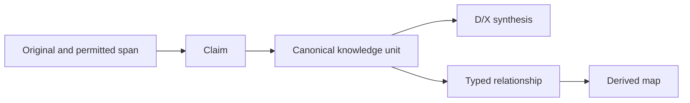

# Data model

[Español](../es/data-model.md) · [Architecture](architecture.md) · [Transcripts](transcripts.md)

## Storage and contracts

The primary data model is files, not relational tables: Markdown with YAML properties in the vault; immutable JSON, exact raw bytes and permission events in the bank. SQLite is a derived index. The portable transfer contract is [vNext-0.9](../../contratos/vNext-0.9/Contrato_Traspaso_vNext.md); operational types are defined in [the registry](../../modelo/tipos_entidad.json), and transcript schemas live in [modelo/transcripciones](../../modelo/transcripciones/).

Do not translate schema keys, enums, IDs or runtime paths when writing English notes or documentation. Human-readable titles may differ; identity remains in properties.

| Record | Identity and important fields | Rule |
|---|---|---|
| Operational note | `id`, `tipo`, `clase`, `estado_editorial`, `estado_conocimiento`, `vigencia`, `sensibilidad`, `fuentes`, `registrado_en` | Use a real catalog type and its prefix/folder. `entidad` is not a generic catalog type. |
| D/X document | `doc_id`, class, revision, source references and block IDs | D01–D07/X01–X07 are document families, not mandatory files or operational types. Preserve existing block IDs on ordinary revisions. |
| Source card | `id`, locator, reading state and source metadata | `fuente` writes `id` in vault frontmatter. `source_id` belongs to source/transfer or receipt contracts, not this field. A card does not prove this session read its original. |
| Discovery/session | `id` with CAP/SES identity | `capturar` and `continuidad` write `id`, not `capture_id`/`session_id`. Provisional work is not approved knowledge. |
| Typed relationship | Endpoints, predicate, scope, sources, review state | A wikilink or co-occurrence does not prove the relationship. |
| Transcript | `tr_id`, version lineage, original SHA, occurrences, state dimensions | A provider occurrence is not a verified speaker identity; capture completeness is version-specific. |
| Analysis | `run_id`, `segment_bundle`, claims, relations, `subject_matrix`, `global_reconciliation`, taxonomy and permission snapshot | Structural coverage and semantic acceptance are separate. |
| Source span | `tr_id`, `version_id`, SHA and UTF-8 byte offsets | `[start,end)` uses bytes with an exclusive end, not character positions. Check the extracted bytes and UTF-8 boundaries. |
| External reference | `reference_id`, `version_id`, locator, hash, reading/admissibility metadata, dependencies | It can represent an authorized ordinary file without converting it into a transcript. |

## Independent state dimensions

| Dimension | Runtime values |
|---|---|
| Editorial | `borrador`, `en_revision`, `aprobado`, `retirado` |
| Coverage per question | `sin_fuente`, `parcial`, `suficiente_para_tarea`, justified `no_aplica` |
| Knowledge per claim | `hecho_observado`, `decision_aprobada`, `propuesta`, `hipotesis`, `historico`, `pendiente`, `desconocido`, `conflicto` |
| Validity | `vigente`, `futuro`, `superseded`, `caducado`, `sin_verificar` |
| Evidence | `documental_directo`, `testimonio_atribuido`, `observacion`, `derivado_calculado`, `sin_fuente`, `fuentes_en_conflicto` |
| Sensitivity | `interno`, `confidencial`, `restringido` |

These summarize the knowledge contract; individual transcript schemas have their own field-level constraints. Never replace a schema enum with a plausible synonym. Approval of a document does not establish a payment, contractual validity or a universal offer. Preserve offered, quoted, accepted, contracted, delivered, invoiced and collected as distinct business states.

## Relationships and authority

Authority is resolved for question, subject, entity, context, time interval, source and permission. File modification time does not win a conflict. General terms do not replace a particular accepted agreement. One independent unit owns each material assertion; other notes link to it or develop a different implication.

The 27 operational distinctions organize possible entities, offers, processes, decisions, cases and resources. They remain a candidate taxonomy, not a required organization chart. Tags are navigation; relationships require source, direction, predicate, scope and ratification state.

## Names, lineage and constraints

New filenames come from readable titles, normalized to Unicode NFC with unsafe path characters removed. Case-insensitive collisions are rejected. Lookups use properties rather than guessing `ID.md`. Existing renames require a private plan, exact `sha_plan`, backup and link/Canvas validation; see [operations](operations.md).

Transcript versions and analysis runs are immutable historical records. A replacement run changes current selection, not previous bytes. A source-card transition must follow the immediate source-version successor or direct superseding run, retain F-ID/path and preserve history. Current permissions must cover historical dependencies too.

External-reference versions include metadata and dependencies, not just file bytes. Grants do not inherit across versions. A partially read source requires explicit, hashed `read_spans` and requested spans within their union; `reading_state=partial` remains true. A remote locator without verified bytes remains metadata, not readable evidence for application.

The integrator checks IDs, types, frontmatter, duplicates, links, source dependencies and snapshots. It cannot infer truth, consent, identity or legal authority from valid JSON. There is no automatic delete cascade or general schema migration promised by this model.

## Source references

Spanish references: [semantic standards](../ESTANDARES_CONOCIMIENTO.md), [network specification](../ESPECIFICACION_RED_CONOCIMIENTO_V0_4.md), [readable names](../NOMBRES_LEGIBLES.md), [external references](../REFERENCIAS_EXTERNAS_D.md). Structure adapted from [ai-cursor-init data-model template](https://github.com/mgiovani/ai-cursor-init/blob/fc15400e4baab4607f408f5b83fed19263e564e3/.cursor/cursor-init/templates/diagrams/data_model_comprehensive.md); SQL-table and migration placeholders were replaced by the actual file contracts.
