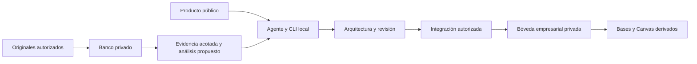

# Arquitectura

[English](../en/architecture.md) · [Modelo de datos](data-model.md) · [Operaciones](operations.md)

## Contexto y objetivos

Obsidian-Bussines-Brain combina herramientas Python locales y un contrato operativo para que un agente desarrolle conocimiento empresarial con su dueño. El repositorio público distribuye código, metodología, skills, plantillas y ejemplos sintéticos. La bóveda privada contiene conocimiento de trabajo; un banco privado separado conserva transcripciones. Son tres superficies distintas, no réplicas para sincronizar.

El objetivo es conocimiento útil y corregible: explicar decisiones y excepciones, localizar evidencia original y apoyar una tarea empresarial real. Instalar una bóveda sólo prueba infraestructura. La cantidad de documentos, un esquema válido o un comando exitoso no demuestran comprensión empresarial.

## Componentes e interfaces

| Componente | Implementación | Responsabilidad y límite |
|---|---|---|
| Instrucciones del agente | `AGENTS.md`, `.agents/skills/`, `guia/` | Enrutar intención, recuperar evidencia, desarrollar contenido y obtener aprobación aplicable. No instala un agente de fondo. |
| CLI empresarial | `scripts/cerebro.py` | Comandos locales explícitos de creación, validación, descubrimiento, documentos, relaciones y navegación. |
| Contrato de traspaso | `contratos/vNext-0.9/` | Manifiesto portable, bloques, procedencia y autoridad. La importación prepara y valida archivos; no es un migrador universal. |
| Modelo de conocimiento | `modelo/tipos_entidad.json`, `plantilla_boveda/` | 27 distinciones operativas candidatas, documentos D/X y vistas Bases nativas; no 27 notas ni departamentos obligatorios. |
| Pipeline de transcripciones | `scripts/transcripciones.py`, `scripts/transcripciones_*.py` | Custodia de bytes, ledger de permisos, segmentos, análisis del agente, recuperación y candidatos derivados. No llama a un LLM. |
| Integración | `scripts/transcripciones_integracion.py`, `scripts/integracion_d.py` | Preparar, verificar, respaldar, aplicar y restaurar lotes expresamente autorizados. No infiere aprobación editorial. |
| Interfaz de usuario | Markdown, Properties, Bases y Canvas de Obsidian | Conocimiento legible y navegación derivada. No incluye frontend web ni servidor REST. |

Python usa PyYAML y jsonschema según `requirements.txt`. SQLite sirve al índice reconstruible de transcripciones; no es el almacenamiento primario. No se requiere nube, contenedores, base alojada, daemon de telemetría ni proveedor automático de modelos.

## Flujo de datos

1. Resolver una bóveda existente mediante `obsidian-router` externo antes de leer sus archivos. La ventana activa no selecciona destino. Si falta la dependencia, continuar fuera de la bóveda el trabajo autorizado y declarar integración pendiente.
2. Preservar transcripciones autorizadas antes de resumir. Documentos ordinarios, código y preguntas no se convierten en transcripciones por su longitud.
3. Recuperar originales admisibles y notas previas, diseñar unidades independientes y desarrollar propuestas. Las síntesis D/X enlazan al dueño canónico de los datos cambiantes sin duplicarlos.
4. Validar cambios y ámbito exacto de fuentes. Aplicar únicamente con los controles pertinentes de autorización, huella, respaldo y journal.
5. Probar recuperación y un caso negativo, e inspeccionar la presentación en Obsidian. La navegación sigue siendo derivada.

## Fiabilidad, rendimiento y seguridad

El banco usa locks cooperantes y publicación inmutable/atómica. La integración registra intención antes de cada reemplazo, mantiene respaldos externos y permite reanudar o restaurar. **No** promete una transacción atómica del lote completo ni excluir un editor no cooperante. Detener escritores durante aplicación y restauración; una edición posterior bloquea una reversión ciega.

Las consultas de transcripciones son léxicas. Memorias por solicitud reducen reconstrucciones del ledger y dependencias, y caducan al terminar. Huellas antes/después rechazan cambios con `SNAPSHOT_CHANGED`. Sigue siendo un control optimista lineal en bytes del banco; no es recuperación semántica ni snapshot atómico. No hay objetivos aceptados de caudal, latencia o disponibilidad empresarial.

La sensibilidad no es ACL. Los permisos son declaraciones del operador por versión, empresa, audiencia y finalidad, no autenticación. Los exportados públicos excluyen fuentes empresariales, manifiestos con bytes privados y credenciales. Ver [seguridad](security.md).

## Alternativas y gates pendientes

Bases nativo es la navegación predeterminada; los plugins comunitarios son opcionales y requieren revisión separada. Investigar Obsidian Projects no autoriza instalarlo. Copiar directamente entre Git público y bóveda activa rompe la separación producto/instancia. No están implementados servicio alojado, sincronización ERP/CRM automática, ACL multiusuario ni migraciones universales.

El candidato local aún requiere comprobaciones GUI/versiones por instancia, revisión semántica independiente y aceptación del dueño para lo que se afirme. Diseños antiguos pueden llamar futuras a capacidades hoy implementadas de forma acotada. Usar código, pruebas y esta guía para capacidad actual; conservar los diseños originales como procedencia.

## Referencias fuente

[Arquitectura inicial](../ARQUITECTURA.md), [red de conocimiento](../ESPECIFICACION_RED_CONOCIMIENTO_V0_4.md), [estado real](../ESTADO_REAL.md), [decisiones abiertas](../DECISIONES_ABIERTAS.md). La estructura adapta la plantilla de arquitectura de [ai-cursor-init en el commit revisado](https://github.com/mgiovani/ai-cursor-init/blob/fc15400e4baab4607f408f5b83fed19263e564e3/.cursor/cursor-init/templates/architecture/architecture_google.md); las afirmaciones de implementación proceden de este repositorio.
