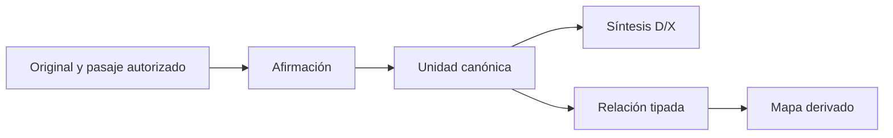

# Modelo de datos

[English](../en/data-model.md) · [Arquitectura](architecture.md) · [Transcripciones](transcripts.md)

## Almacenamiento y contratos

El modelo primario usa archivos, no tablas relacionales: Markdown con propiedades YAML en la bóveda; JSON inmutable, bytes originales y eventos de permisos en el banco. SQLite es un índice derivado. El contrato portable es [vNext-0.9](../../contratos/vNext-0.9/Contrato_Traspaso_vNext.md); los tipos operativos viven en [el registro](../../modelo/tipos_entidad.json) y los esquemas TR en [modelo/transcripciones](../../modelo/transcripciones/).

No traducir claves, enums, IDs ni rutas de ejecución al escribir notas o documentación en inglés. Los títulos legibles pueden cambiar; la identidad permanece en propiedades.

| Registro | Identidad y campos importantes | Regla |
|---|---|---|
| Nota operativa | `id`, `tipo`, `clase`, `estado_editorial`, `estado_conocimiento`, `vigencia`, `sensibilidad`, `fuentes`, `registrado_en` | Usar tipo real, prefijo y carpeta del catálogo. `entidad` no es un tipo genérico válido. |
| Documento D/X | `doc_id`, clase, revisión, fuentes e IDs de bloque | D01–D07/X01–X07 son familias documentales, no archivos obligatorios ni tipos operativos. Conservar bloques en revisiones ordinarias. |
| Ficha de fuente | `id`, localizador, lectura y metadatos | `fuente` escribe `id` en frontmatter. `source_id` pertenece a contratos de fuente/traspaso o recepción, no a este campo. La ficha no prueba lectura del original en esta sesión. |
| Descubrimiento/sesión | `id` con identidad CAP/SES | `capturar` y `continuidad` escriben `id`, no `capture_id`/`session_id`. El trabajo provisional no es conocimiento aprobado. |
| Relación tipada | Extremos, predicado, ámbito, fuentes, revisión | Un wikilink o coocurrencia no prueba la relación. |
| Transcripción | `tr_id`, linaje de versiones, SHA original, ocurrencias, ejes de estado | Una ocurrencia del proveedor no verifica identidad del hablante; completitud corresponde a cada versión. |
| Análisis | `run_id`, `segment_bundle`, claims, relaciones, `subject_matrix`, `global_reconciliation`, taxonomía y snapshot de permisos | Cobertura estructural y aceptación semántica son distintas. |
| Pasaje fuente | `tr_id`, `version_id`, SHA y offsets UTF-8 | `[start,end)` usa bytes y fin exclusivo, no caracteres. Comprobar extracto y límites UTF-8. |
| Referencia externa | `reference_id`, `version_id`, localizador, hash, lectura/admisibilidad, dependencias | Representa archivos ordinarios autorizados sin convertirlos en transcripciones. |

## Ejes de estado independientes

| Eje | Valores de ejecución |
|---|---|
| Editorial | `borrador`, `en_revision`, `aprobado`, `retirado` |
| Cobertura por pregunta | `sin_fuente`, `parcial`, `suficiente_para_tarea`, `no_aplica` justificado |
| Conocimiento por afirmación | `hecho_observado`, `decision_aprobada`, `propuesta`, `hipotesis`, `historico`, `pendiente`, `desconocido`, `conflicto` |
| Vigencia | `vigente`, `futuro`, `superseded`, `caducado`, `sin_verificar` |
| Evidencia | `documental_directo`, `testimonio_atribuido`, `observacion`, `derivado_calculado`, `sin_fuente`, `fuentes_en_conflicto` |
| Sensibilidad | `interno`, `confidencial`, `restringido` |

Resumen del contrato de conocimiento: cada esquema de transcripciones tiene restricciones específicas por campo. No sustituir un enum por un sinónimo plausible. Aprobar un documento no acredita pago, vigencia contractual ni oferta universal. Separar ofrecido, cotizado, aceptado, contratado, entregado, facturado y cobrado.

## Relaciones y autoridad

La autoridad se resuelve por pregunta, asunto, entidad, contexto, intervalo temporal, fuente y permiso. La fecha del archivo no gana conflictos. Condiciones generales no reemplazan acuerdos particulares aceptados. Cada afirmación material tiene un dueño canónico; otras notas lo enlazan o desarrollan otra implicación.

Las 27 distinciones operativas organizan posibles entidades, ofertas, procesos, decisiones, casos y recursos. Son taxonomía candidata, no organigrama obligatorio. Tags son navegación; relaciones requieren fuente, dirección, predicado, ámbito y ratificación.

## Nombres, linaje y restricciones

Los nombres nuevos provienen de títulos legibles normalizados a Unicode NFC, sin caracteres inseguros. Se rechazan colisiones incluso sólo por mayúsculas. Se recupera por propiedades sin suponer `ID.md`. Renombrar existentes requiere plan privado, `sha_plan` exacto, respaldo y validación de enlaces/Canvas; ver [operaciones](operations.md).

Versiones TR y runs son históricos inmutables. Un run sustituto cambia la selección actual, no los bytes previos. La transición de ficha exige versión sucesora inmediata o run que sustituye directamente, conserva F-ID/ruta e historial. Los permisos actuales también deben cubrir dependencias históricas.

Las versiones de referencias externas incluyen metadatos y dependencias, no sólo bytes. No heredan permisos. Una fuente parcialmente leída exige `read_spans` con hash y pasajes solicitados contenidos en su unión; conserva `reading_state=partial`. Un localizador remoto sin bytes verificados es metadato, no evidencia leída para aplicar.

El integrador valida IDs, tipos, propiedades, duplicados, enlaces, dependencias y snapshots. No infiere verdad, consentimiento, identidad ni autoridad legal de JSON válido. Este modelo no promete cascadas automáticas de borrado ni migración general de esquemas.

## Referencias fuente

[Estándares semánticos](../ESTANDARES_CONOCIMIENTO.md), [especificación de red](../ESPECIFICACION_RED_CONOCIMIENTO_V0_4.md), [nombres legibles](../NOMBRES_LEGIBLES.md), [referencias externas](../REFERENCIAS_EXTERNAS_D.md). Estructura adaptada de [la plantilla de datos ai-cursor-init](https://github.com/mgiovani/ai-cursor-init/blob/fc15400e4baab4607f408f5b83fed19263e564e3/.cursor/cursor-init/templates/diagrams/data_model_comprehensive.md); sus placeholders SQL/migraciones se sustituyeron por contratos reales de archivos.
